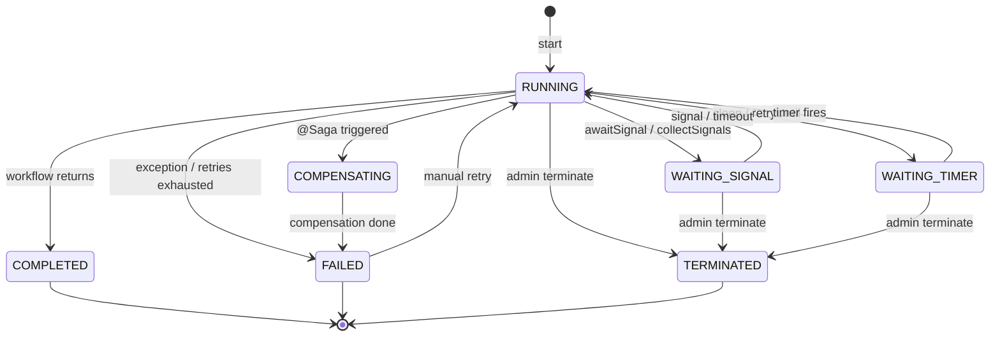

# Core Concepts

**Maestro is an embeddable durable workflow engine delivered as a Spring Boot Starter.**

[← Back to README](../README.md)

---

## Overview

Maestro gives your Spring Boot microservice Temporal.io-grade workflow durability without a central server. Add a starter dependency, point it at your existing Postgres, Kafka, and Valkey/Redis, and your workflows become crash-recoverable.

The three infrastructure components (store, messaging, lock) are each defined as a Service Provider Interface (SPI), allowing different implementations to be swapped via configuration. See [Configuration](configuration.md) for available backends.

The engine uses **hybrid memoization**: every activity call is intercepted by a proxy that checks Postgres for a stored result at the current sequence number. If found (replay), the stored result is returned instantly without re-execution. If not found (live), the activity executes, its result is persisted, and execution continues. On recovery after a crash, the workflow method is re-invoked from the top -- completed steps replay in microseconds, and execution resumes from the first uncompleted step.

---

## Durable Workflows

A durable workflow is a plain Java class annotated with `@DurableWorkflow`. It contains the orchestration logic that calls activities, waits for signals, sleeps, and branches in parallel. The engine runs each workflow instance on its own Java virtual thread.

Each workflow class must have exactly one method annotated with `@WorkflowMethod`. This is the entry point that the engine invokes when a new workflow starts and re-invokes during crash recovery.

```java
@DurableWorkflow(name = "order-fulfilment", taskQueue = "orders")
public class OrderFulfilmentWorkflow {

    @ActivityStub(startToCloseTimeout = "PT30S",
                  retryPolicy = @RetryPolicy(maxAttempts = 3))
    private InventoryActivities inventory;

    @ActivityStub(startToCloseTimeout = "PT10S")
    private NotificationActivities notifications;

    private volatile String currentStep = "CREATED";

    @WorkflowMethod
    public OrderResult fulfil(OrderInput input) {
        var workflow = WorkflowContext.current();

        currentStep = "RESERVING_INVENTORY";
        var reservation = inventory.reserve(input.items());

        currentStep = "AWAITING_PAYMENT";
        var payment = workflow.awaitSignal(
            "payment.result", PaymentResult.class, Duration.ofHours(1));

        currentStep = "COMPLETED";
        notifications.notifyCustomer(input.customerId(), "Order confirmed!");
        return OrderResult.success(input.orderId(), reservation.warehouseId());
    }
}
```

**Key points:**

- `name` defaults to the class simple name if omitted. It correlates instances with their implementation during recovery.
- `taskQueue` defaults to `"default"`. It names the concurrency bucket the workflow's runs and their live activities count against — the per-node limits configured under `maestro.worker.task-queues[]` (see [Worker Configuration](configuration.md#worker-configuration)); a queue not configured there is unbounded. It does not route: a workflow runs in-process on the node that starts it, or on the node that recovers it.
- The `@WorkflowMethod` may accept zero or one parameter (the workflow input) and its return type is serialized as the workflow output.
- **One `@WorkflowMethod` per class.** Multiple workflow types require separate classes.
- **One object per run.** The engine instantiates the workflow class for every start, recovery and retry. Instance fields are per-run state; never put per-instance state in `static` fields.

---

## Activities

Activities are the units of work that a workflow orchestrates. They represent the actual side-effects: calling an API, writing to a database, sending a message. Activities are defined as interfaces annotated with `@Activity` and injected into workflows via `@ActivityStub` fields.

### Defining an activity interface

```java
@Activity
public interface InventoryActivities {

    @Compensate("releaseReservation")
    ReservationConfirmation reserve(List<OrderItem> items);

    void releaseReservation(ReservationConfirmation reservation);
}
```

### Implementing an activity

The implementation is a plain Spring bean. No special annotations are needed on the class itself.

```java
@Service
public class InventoryService implements InventoryActivities {

    @Override
    public ReservationConfirmation reserve(List<OrderItem> items) {
        // Real inventory logic: call database, external API, etc.
        return new ReservationConfirmation("rsv-123", "warehouse-east", totalPrice);
    }

    @Override
    public void releaseReservation(ReservationConfirmation reservation) {
        // Undo the reservation
    }
}
```

### Injecting into a workflow

```java
@ActivityStub(startToCloseTimeout = "PT30S",
              retryPolicy = @RetryPolicy(maxAttempts = 3,
                                         initialInterval = "PT1S",
                                         maxInterval = "PT1M",
                                         backoffMultiplier = 2.0))
private InventoryActivities inventory;
```

**How memoization works:** When the workflow calls `inventory.reserve(items)`, the activity proxy:

1. Reads the current sequence number from the `WorkflowContext` (e.g., sequence `1`).
2. Checks Postgres for a stored event at `(workflowInstanceId, 1)`.
3. **Replay (found):** Deserializes and returns the stored result. No execution occurs.
4. **Live (not found):** Executes the real activity method, serializes and persists the result, then returns it.

This is what makes workflows crash-recoverable. After a JVM restart, the engine re-invokes the `@WorkflowMethod`. Each activity call replays its stored result in microseconds until execution reaches the first step that never completed, then resumes live execution from there.

### Retry policy

The `@RetryPolicy` annotation configures automatic retries for failed activity invocations:

| Attribute | Default | Description |
|---|---|---|
| `maxAttempts` | `3` | Total attempts including the initial call |
| `initialInterval` | `"PT1S"` | Initial delay between retries (ISO 8601) |
| `maxInterval` | `"PT1M"` | Maximum delay cap (ISO 8601) |
| `backoffMultiplier` | `2.0` | Multiplier applied after each retry |
| `retryableExceptions` | `{}` (all) | Only retry these exception types |
| `nonRetryableExceptions` | `{}` (none) | Never retry these exception types |

Backoff formula: `delay = min(initialInterval * backoffMultiplier^attempt, maxInterval)`.

**Timeouts.** `@ActivityStub(startToCloseTimeout = ...)` (default `PT30S`) bounds each *attempt* on the wall clock, from invocation to return; every retry gets the full timeout afresh, and backoff waits do not count against it. Each attempt runs on its own virtual thread; one still running at the timeout is cancelled — its thread is interrupted — and fails with `ActivityTimeoutException`. The workflow does not wait for it to stop, and anything it returns afterwards is discarded, never memoized, so an activity that ignores interruption keeps running in the background with no effect on the workflow. `ActivityTimeoutException` is an ordinary failure under the retry policy: retried by default, and listing it in `nonRetryableExceptions` makes a timeout terminal. Detect it with `e.causedBy(ActivityTimeoutException.class)`, which also holds on replay.

**What survives a crash.** The attempt counter is in-memory; after a crash the activity restarts at attempt 1 with the full backoff schedule; the durable guarantee is that a *completed* attempt is never re-executed.

### Handling activity failures in workflow code

An activity's exception **always** reaches the workflow method wrapped in `ActivityExecutionException`, both live and on replay. The original exception is available as `getCause()` and is tested with `causedBy(Class)`:

```java
try {
    provider.charge(request.paymentMethod(), request.amount());
} catch (ActivityExecutionException e) {
    if (e.causedBy(PaymentDeclinedException.class)) {
        // handle the business outcome
    } else {
        throw e;
    }
}
```

Why the wrapper is kept: on replay the engine may have to *reconstruct* the cause from its recorded class name (for example when the type has no public `(String)` constructor, or is no longer on the classpath), in which case `getCause()` is a `ReconstructedActivityFailure` rather than the original type. `causedBy` handles both cases, so `catch (PaymentDeclinedException e)` directly would silently never match.

Retry interaction: an exception you intend to catch as a business outcome belongs in `nonRetryableExceptions`. Otherwise the policy retries it to exhaustion before the workflow ever sees it (30 attempts with up-to-10-minute backoff in the payment sample's case).

**Never catch-and-continue a stand-down: rethrow `DuplicateEventException` and `StaleRunException`.** These two are not activity failures, and they are not wrapped in `ActivityExecutionException`. They mean *another runner owns this workflow* — a peer node adopted it while this one lost its instance lock (or runs without a lock backend), and either an append of this run collided with the peer's event at the same sequence (`DuplicateEventException`) or a fresh read found the workflow already finished by the peer (`StaleRunException`). The engine's response is to stand the local run down: write nothing, compensate nothing, let the winner's record govern. Both are ordinary `MaestroException`s, so a broad `catch (Exception e)` around an activity call, `sleep()` or `awaitSignal()` *can* intercept them — and if it swallows one, or turns it into a business failure, it costs real work: the next live activity executes a side effect the winner also runs (a second charge, a second email), and rethrowing it as a business failure can run compensations that undo work the winner owns. Let them propagate:

```java
try {
    provider.charge(request.paymentMethod(), request.amount());
} catch (DuplicateEventException | StaleRunException standDown) {
    throw standDown;                       // another runner owns this workflow
} catch (Exception e) {
    // ... genuine failure handling ...
}
```

As a backstop, the engine remembers that a run is stale, whatever the workflow code did with the exception, and stands it down at its *next stop point*: the next live activity (before it acquires a lock, publishes a start or executes anything), the next `sleep()` (before it saves a timer), the next `awaitSignal()` (before it consumes a signal), and the terminal write (a stale run never records `COMPLETED` or `FAILED`, and never compensates). Each throws `StaleRunException`. Only the plain code you run between the swallowed exception and that point is beyond the engine's reach.

---

## The Determinism Rule

**Code between activity calls must be deterministic.** This is the single most important rule for workflow authors.

Because the engine replays the workflow method during crash recovery, any non-deterministic code between activity calls will produce different results on replay, corrupting the memoization sequence. The workflow will diverge from its stored event history and fail.

### Do / Don't table

| Don't (non-deterministic) | Do (deterministic alternative) |
|---|---|
| `Math.random()` | `workflow.randomUUID()` |
| `UUID.randomUUID()` | `workflow.randomUUID()` |
| `LocalDateTime.now()` | `workflow.currentTime()` |
| `Instant.now()` | `workflow.currentTime()` |
| `Thread.sleep(ms)` | `workflow.sleep(duration)` |
| Direct HTTP calls | Wrap in an activity method |
| File I/O | Wrap in an activity method |
| Database queries | Wrap in an activity method |

**Safe between activity calls:** conditionals, loops, string manipulation, arithmetic, creating DTOs from activity results, logging. These are deterministic because they operate on values that were already memoized.

Editing the workflow method itself is the other way to break replay -- an in-flight instance resumes into code that no longer matches what it recorded. Gate the change with [`workflow.version()`](#versioning-workflow-code).

Since this release the engine checks the recorded step name on every replayed step: a renamed, removed or reordered activity no longer silently replays another step's payload — the run stands down with `StandDownReason.NONDETERMINISTIC_HISTORY` (metric tag `nondeterministic_history`), nothing is written, the `maestro.standdown` meter increments and the WARN names the expected and recorded step. Gate such edits behind `workflow.version()` (below).

```java
@WorkflowMethod
public OrderResult fulfil(OrderInput input) {
    var workflow = WorkflowContext.current();
    var reservation = inventory.reserve(input.items());

    // SAFE: conditional logic on memoized data
    if (reservation.total().compareTo(BigDecimal.valueOf(1000)) > 0) {
        notifications.notifyRiskTeam(input.orderId());
    }

    // WRONG: non-deterministic code between activity calls
    // var now = Instant.now();              // breaks replay
    // var id = UUID.randomUUID().toString(); // breaks replay

    // RIGHT: use memoized alternatives
    var now = workflow.currentTime();
    var id = workflow.randomUUID();

    return new OrderResult(reservation, now, id);
}
```

---

## Signals

Signals deliver external data into a running workflow. A workflow can pause and wait for a named signal, and any external caller can send that signal at any time.

### Awaiting a signal

`workflow.awaitSignal(signalName, type, timeout)` parks the workflow's virtual thread until the signal arrives or the timeout elapses. On timeout, it throws `SignalTimeoutException` -- it does **not** return null.

```java
var workflow = WorkflowContext.current();

try {
    PaymentResult payment = workflow.awaitSignal(
        "payment.result", PaymentResult.class, Duration.ofHours(1));

    // Signal received -- payment contains the payload
    if (payment.success()) {
        shipping.createShipment(orderId, address, warehouseId);
    }
} catch (SignalTimeoutException e) {
    // No signal received within 1 hour
    notifications.notifyCustomer(customerId, "Payment timed out");
    return OrderResult.failed("Payment timed out");
}
```

The timeout is durable: it is a timer row in `maestro_workflow_timer`, so a crash does not restart the clock, and in tests advancing the test clock just past the timeout (`env.advanceTime(timeout.plusSeconds(1))`) fires it deterministically — see [Testing](testing.md).

### Collecting multiple signals

`workflow.collectSignals(signalName, type, count, timeout)` waits for exactly `count` signals with the same name. This enables quorum patterns like "wait for 3 out of 5 approvals":

```java
List<ApprovalResult> approvals = workflow.collectSignals(
    "manager.approval", ApprovalResult.class, 3, Duration.ofDays(7));
```

### Sending a signal

From outside the workflow, use the `MaestroClient`:

```java
maestro.getWorkflow("order-abc").signal("payment.result", paymentResult);
```

### Signal durability

Signals are persisted to Postgres immediately on delivery. This means:

- **Signal arrives before `awaitSignal()`:** Stored and consumed when the workflow reaches the await point.
- **Signal arrives before the workflow even starts:** Stored with a null instance ID, adopted when the workflow starts.
- **Signal arrives while the service is down:** Persisted, found during recovery.

Signals are never lost — unless the operator has explicitly disabled redelivery (`maestro.messaging.redelivery.enabled=false`), which restores at-most-once handler semantics; see [Configuration Reference](configuration.md). See [Self-Recovery](self-recovery.md) for the full durability model.

---

## Durable Timers

`workflow.sleep(Duration)` creates a persistent timer in Postgres, parks the workflow's virtual thread, and resumes when the timer fires. Unlike `Thread.sleep()`, durable timers survive JVM restarts.

```java
var workflow = WorkflowContext.current();

// Reserve inventory, then wait 30 minutes for payment
var reservation = inventory.reserve(items);
workflow.sleep(Duration.ofMinutes(30));

// This code runs 30 minutes later -- even if the JVM restarted
var status = payment.checkStatus(orderId);
```

A leader-elected **timer poller** runs on one node in the cluster, querying Postgres for due timers and firing them. The leader election uses Valkey with a 15-second TTL lease.

### Cancelling a timer

An operator (or, eventually, an admin action) can cancel a pending timer via `WorkflowExecutor.cancelTimer(workflowId, timerId, timerDbId)`. This is the *only* supported cancellation path -- there is no store-only cancel, because a store-only cancel would leave the parked workflow with nothing to wake it.

Cancelling a timer a workflow is currently waiting on unparks it with a durable, catchable outcome: `sleep()` throws `TimerCancelledException` instead of returning, both on the live path and on every later replay.

```java
try {
    workflow.sleep(Duration.ofMinutes(30));
    // ... normal path
} catch (TimerCancelledException e) {
    // an operator skipped the cooling-off period -- take the fallback branch
}
```

Left uncaught, `TimerCancelledException` propagates like any other exception: saga compensation runs (if registered) and the instance ends `FAILED`. Both outcomes -- caught and uncaught -- are deterministic and visible, unlike a cancel that silently strands the workflow in `WAITING_TIMER` forever.

Cancellation is arbitrated the same way firing is: a compare-and-set on the timer row (`PENDING -> CANCELLED`). `cancelTimer` returns `true` if it won the race, `false` if the timer had already fired or was already cancelled -- the caller is told, rather than left to guess.

`awaitSignal(name, timeout)` arms a durable timer row for its timeout (timer ID `await-signal-<seq>`, where `seq` is the sequence the await allocated), so the deadline survives restarts and is honoured from the original arming time. `cancelTimer` does reach it: a cancelled await timer ends the await with `SignalTimeoutException` on its next wake, because the timer row is the arbiter and a non-`PENDING` row means the deadline is spent.

---

## Queries

Queries let external callers read the current state of a running workflow without modifying it. Define query handlers with `@QueryMethod` on the workflow class.

```java
@DurableWorkflow(name = "order-fulfilment", taskQueue = "orders")
public class OrderFulfilmentWorkflow {

    private volatile String currentStep = "CREATED";
    private volatile int itemsProcessed = 0;

    @WorkflowMethod
    public OrderResult fulfil(OrderInput input) {
        currentStep = "RESERVING_INVENTORY";
        var reservation = inventory.reserve(input.items());
        itemsProcessed = input.items().size();
        currentStep = "AWAITING_PAYMENT";
        // ...
    }

    @QueryMethod
    public OrderStatus getStatus() {
        return new OrderStatus(currentStep);
    }

    @QueryMethod(name = "progress")
    public int getItemsProcessed() {
        return itemsProcessed;
    }
}
```

**Invoking a query** from outside the workflow:

```java
OrderStatus status = maestro.getWorkflow("order-abc")
    .query("getStatus", OrderStatus.class);

int progress = maestro.getWorkflow("order-abc")
    .query("progress", Integer.class);
```

**Thread safety:** Query methods are invoked from the **caller's thread**, not the workflow's virtual thread. Use `volatile` fields, `AtomicReference`, or explicit synchronization to ensure visibility of state written by the workflow thread.

**Single-node contract:** A query is answered by the node whose engine is currently running the workflow — the one holding its instance lock. Any other node, and any node after the workflow reaches `COMPLETED`/`FAILED`/`TERMINATED`, throws `WorkflowNotQueryableException`. A load-balanced `GET /status` on a multi-node service therefore fails on the non-owning nodes; route the request to the owner, or serve status from `WorkflowHandle.status()`/`result()` (durable, any node) or your own projection. Cross-node query routing is not implemented.

**Read-only contract:** Query methods must not modify workflow state or trigger side effects. Doing so will corrupt determinism and break replay.

---

## Saga Compensation

Sagas provide automatic rollback when a workflow fails partway through. Annotate the `@WorkflowMethod` with `@Saga` and declare compensation methods on your activity interfaces with `@Compensate`.

### Declarative compensation

```java
@Activity
public interface InventoryActivities {

    @Compensate("releaseReservation")
    ReservationConfirmation reserve(List<OrderItem> items);

    void releaseReservation(ReservationConfirmation reservation);
}
```

```java
@WorkflowMethod
@Saga(parallelCompensation = false)
public OrderResult fulfil(OrderInput input) {
    // Step 1: reserve inventory -- compensation registered automatically
    var reservation = inventory.reserve(input.items());

    // Step 2: charge payment
    var payment = payment.charge(input.paymentMethod(), reservation.total());

    // Step 3: arrange shipment -- if this fails:
    //   1. payment.refund() runs (most recent first)
    //   2. inventory.releaseReservation() runs
    var shipment = shipping.createShipment(input.orderId(), input.shippingAddress());

    return OrderResult.success(input.orderId(), shipment.trackingNumber());
}
```

### Manual compensation

For cases where declarative `@Compensate` is not flexible enough, push compensations manually:

```java
var workflow = WorkflowContext.current();

var reservation = inventory.reserve(items);
workflow.addCompensation(() -> inventory.releaseReservation(reservation));

// Or with a name for logging
workflow.addCompensation("release-reservation",
    () -> inventory.releaseReservation(reservation));
```

### Compensation ordering

Compensations form a **LIFO stack** -- they unwind in reverse registration order (most recent first). Set `@Saga(parallelCompensation = true)` to execute all compensations concurrently instead.

Compensations registered inside `parallel()` branches (a `@Compensate` activity called in a branch, or `addCompensation` in a branch) are held until the fork joins and then pushed in **branch-index order** -- branch 0's entries first, in the order branch 0 registered them, then branch 1's, and so on; a nested `parallel()` does the same into its enclosing branch -- never in the order the branches happen to finish. That holds on the failure path too: a branch that registered a compensation before a sibling failed still has it unwound. Finish order is a thread race a recovery replay need not reproduce; branch-index order is deterministic, so a saga recovered mid-compensation unwinds the same entries in the same order.

Compensation calls go through the activity proxy and are therefore memoized, retriable, and replayable, just like normal activity calls.

### Compensation argument resolution

The compensation method's arguments are resolved by convention:

1. **No parameters:** Called with no arguments.
2. **Single parameter assignable from the activity's return type:** The return value is passed.
3. **Parameters matching the activity's parameters:** The original arguments are passed.

Incompatible signatures are detected at startup (fail-fast).

---

## Parallel Execution

`workflow.parallel(List<Callable<T>>)` spawns N virtual threads and executes them concurrently. Each branch gets an independent sequence space for memoization.

```java
var workflow = WorkflowContext.current();

List<ShipmentConfirmation> shipments = workflow.parallel(List.of(
    () -> shipping.createShipment("order-1", addressA, "warehouse-east"),
    () -> shipping.createShipment("order-2", addressB, "warehouse-west"),
    () -> shipping.createShipment("order-3", addressC, "warehouse-east")
));
```

### Branch sequence blocks

When parallel execution forks at sequence step `5`, each branch is allocated its own block of sequence numbers: branch *i* starts at `5*1000 + (i+1)*1000` (bases `6000`, `7000`, `8000`), with up to 999 sequence slots per branch (most steps take one slot; `sleep()` takes two — the timer and its wake record) — **the 1000th slot throws `BranchSequenceExhaustedException`, failing the branch and therefore the workflow (its registered compensations run)**; the counter never spills into the sibling's block. Saga compensation entries get the same 1000-slot blocks with the same bound, sequential and parallel alike: an entry that takes a 1000th slot is recorded `COMPENSATION_STEP_FAILED` with that cause, and the remaining entries still run. This means:

- Each branch is independently memoized.
- On replay, each branch replays its own stored events regardless of original execution order.
- Results are returned in the same order as the input task list.

### Depth limit

Every fork level multiplies the sequence by 1000, and the sequence is a 32-bit `int`, so from a parent sequence below ~2,000 any one path through a workflow has room for **two** fork levels. Where a fork sits decides which levels it adds to:

- **Parent-line levels compound.** Each sequential `parallel()` call on the workflow's main line leaves the parent counter past its branch blocks (×1000), and the compensation phase that follows a failure anchors on that counter, so it is a parent-line level too. Two sequential `parallel()` calls fit; one `parallel()` plus compensation fits; two sequential `parallel()` calls plus compensation do not.
- **A nested `parallel()` compounds only within its own branch.** It rebases that branch's counter, never the parent's: after the outer join the parent sits exactly where it would without the nesting (`4000` for a 2-branch fork at seq `1`). So a nested `parallel()` followed by compensation fits (anchor `4001`), and so does a nested `parallel()` followed by a second sequential `parallel()`. A fork nested inside a nested fork does not, nor does a nested fork inside a branch of the second sequential `parallel()`.
- **A fork inside a compensation entry** is one level below the compensation phase. With no forward `parallel()` it fits (entry block `3000`, nested branch blocks from `3,002,000`). After a forward `parallel()` the compensation phase is already the second level (anchor `4001`, entry block `4,002,000`), so the entry's own fork at `4,002,001` cannot be sequenced: the compensation pre-check passes, and **that compensation step is recorded `COMPENSATION_STEP_FAILED` with `SequenceSpaceExhaustedException`** while the remaining entries still run. Under `@Saga(parallelCompensation = true)` a compensation cannot fork at all: parallel-compensation branches run without workflow operations (no `sleep()`, `awaitSignal()` or `parallel()`), so the call fails that step with `IllegalStateException`.

A fork that cannot be sequenced throws `SequenceSpaceExhaustedException` *before* any sequence is consumed. On the forward path that fails the workflow; inside a compensation entry it is recorded as that entry's `COMPENSATION_STEP_FAILED`. The compensation phase itself is checked up front, so **a saga that has already made two sequential `parallel()` calls cannot compensate at all**: its compensation anchor is ≈ 4,004,001–7,005,001 depending on branch counts, and the anchor × 1000 block arithmetic overflows `int`. The workflow is still finished `FAILED`, but **no compensation runs** — the engine logs at `ERROR` the step names of the compensations that could not run, and the operator must compensate manually. This is a known structural limitation; see [Issue 28](open-issues.md#issue-28).

---

## Retry Until

`workflow.retryUntil(supplier, predicate, options)` polls a supplier until a predicate is satisfied, with durable backoff between attempts. This is for polling patterns where the activity succeeds but returns an unsatisfactory result (as opposed to `@RetryPolicy`, which retries on exceptions).

```java
var workflow = WorkflowContext.current();

var options = RetryUntilOptions.builder()
    .maxAttempts(20)
    .maxDuration(Duration.ofHours(2))
    .initialInterval(Duration.ofSeconds(10))
    .maxInterval(Duration.ofMinutes(5))
    .backoffMultiplier(2.0)
    .build();

PaymentStatus status = workflow.retryUntil(
    () -> payment.checkStatus(orderId),       // supplier (must be activity call)
    result -> result.isSettled(),              // predicate
    options
);
```

Each backoff interval creates a durable timer via `workflow.sleep()`, so the entire retry loop survives JVM restarts. The supplier must be a memoized activity call -- passing a raw lambda that performs I/O will break deterministic replay.

Throws `RetryExhaustedException` if all attempts are exhausted or the maximum duration is exceeded.

---

## Versioning Workflow Code

Recovery re-runs the workflow method against the **current** code. Change a workflow while long-lived instances are still in flight and a replaying instance takes the new path from wherever it resumed -- half its work done the old way, the rest the new way.

`workflow.version(changeId, minSupported, maxSupported)` makes the choice of path a durable decision, memoized like any other step:

- **Live (first evaluation):** records `maxSupported` as a `VERSION_MARKER` event at the current sequence slot and returns it.
- **Replay:** returns the *recorded* version -- forever -- even after the code's `maxSupported` moves on. That asymmetry is the point.
- **Histories that predate the change:** resolve to `WorkflowContext.DEFAULT_VERSION` (`-1`) **without consuming a sequence slot**, so introducing a `version()` call into existing code leaves in-flight instances' event logs unshifted.
- **Repeated calls** with the same `changeId` in one run return the same value and record nothing further.

### Shipping a change

```java
// Step 1 — ship the new branch behind a version gate.
var workflow = WorkflowContext.current();
int v = workflow.version("shipping-v2", WorkflowContext.DEFAULT_VERSION, 1);
if (v == WorkflowContext.DEFAULT_VERSION) {
    shipping.dispatch(order);                       // what in-flight instances recorded
} else {
    shipping.dispatchWithCarrier(order, carrier);   // the new branch
}

// Step 2 — once no pre-change instance can still be running, delete the old
// branch and raise the floor.
workflow.version("shipping-v2", 1, 1);
shipping.dispatchWithCarrier(order, carrier);
```

Raise the floor too early and an instance whose recorded version is below `minSupported` fails with `UnsupportedWorkflowVersionException`, naming the changeId, the recorded version and the supported range. That is an ordinary deterministic workflow failure -- saga compensation runs if registered, the instance ends `FAILED`. Restore code carrying the old branch and use the admin **Retry** action: retry clears the failure memos but never the version marker, so the retried run replays the same recorded version.

### Rules

- `changeId` must be stable and unique within the workflow definition. It is recorded in the marker's step name (`$maestro:version:{changeId}`), which is what makes version decisions visible to `DeterminismChecker`.
- **`maxSupported` must be a code constant, not a computed value.** The checker fingerprints `sequence:eventType:stepName` and deliberately does *not* include the payload -- a different recorded version is a different history, not a divergent path -- so a workflow whose `maxSupported` varies between runs (a config lookup, a feature flag, an environment read) passes the determinism check while recording a different version on every new instance. Nothing will tell you. Hard-code the range.
- Resolve a changeId **before** forking parallel branches that depend on it and pass the value in. Branches share the per-run cache, and the cache's get-then-put is not atomic: two branches racing to be the first resolver of the same changeId both miss the cache and **each writes its own marker**, in its own branch's sequence block -- not "whichever branch won". Each slot then replays deterministically. What is nondeterministic is *how many* markers a run writes: on a run where one branch happens to populate the cache before the other peeks, only one marker is recorded, so the event log differs between runs and `DeterminismChecker` reports a fingerprint mismatch. It is caught rather than silent, but it is still a bug in the workflow -- resolving in the parent avoids it entirely. A `version()` call made inside a *single* branch is fine -- it allocates from that branch's own sequence block.
- `VERSION_MARKER` is a 0.4.0 event type. Nodes older than 0.4.0 cannot interpret it: upgrade all nodes of a service together. See [`docs/operations.md` §10](operations.md#10-versioning-and-mixed-version-deploys) for what an older node does when it meets one (it stands down -- no failure, no compensation) and how to read the `maestro.standdown` meter.

---

## WorkflowContext API Reference

Access the context via `WorkflowContext.current()` or `WorkflowContext.workflow()` (alias) from within a workflow method.

```java
var workflow = WorkflowContext.current();
```

| Method | Return Type | Description |
|---|---|---|
| `sleep(Duration)` | `void` | Durable sleep. Creates a persistent timer that survives restarts. |
| `awaitSignal(name, type, timeout)` | `<T> T` | Wait for a named signal. Throws `SignalTimeoutException` on timeout. |
| `collectSignals(name, type, count, timeout)` | `<T> List<T>` | Collect exactly N signals. Throws `SignalTimeoutException` on timeout. |
| `parallel(List<Callable<T>>)` | `<T> List<T>` | Execute branches in parallel on virtual threads. |
| `currentTime()` | `Instant` | Memoized current time. Use instead of `Instant.now()`. |
| `randomUUID()` | `String` | Memoized UUID string. Use instead of `UUID.randomUUID()`. |
| `retryUntil(supplier, predicate, options)` | `<T> T` | Poll with durable backoff. Throws `RetryExhaustedException`. |
| `version(changeId, minSupported, maxSupported)` | `int` | Memoized change-branching. Returns the recorded version on replay; `DEFAULT_VERSION` for a pre-change history. Throws `UnsupportedWorkflowVersionException` below `minSupported`. |
| `addCompensation(Runnable)` | `void` | Push an anonymous compensation onto the saga stack. |
| `addCompensation(name, Runnable)` | `void` | Push a named compensation onto the saga stack. |
| `workflowId()` | `String` | The business workflow ID (e.g., `"order-abc"`). |
| `workflowInstanceId()` | `UUID` | The internal workflow instance UUID (primary key). |
| `workflowType()` | `String` | The workflow type name (from `@DurableWorkflow.name`). |
| `taskQueue()` | `String` | The task queue name. |
| `isReplaying()` | `boolean` | Whether the engine is currently replaying stored events. |

---

## MaestroClient API Reference

Inject `MaestroClient` into your Spring beans to start workflows, send signals, and query state.

```java
@Service
public class OrderService {

    private final MaestroClient maestro;

    public OrderService(MaestroClient maestro) {
        this.maestro = maestro;
    }
}
```

### Starting a workflow (fire and forget)

```java
var options = WorkflowOptions.builder()
    .workflowId("order-" + orderId)
    .build();

UUID instanceId = maestro.newWorkflow(OrderFulfilmentWorkflow.class, options)
    .startAsync(input);
```

`startAsync` accepts the workflow input (or `null` for no-arg workflows) and returns the workflow instance UUID immediately.

### Starting a workflow and waiting for the result

```java
OrderResult result = maestro.newWorkflow(OrderFulfilmentWorkflow.class, options)
    .startAndWait(input, Duration.ofMinutes(5), OrderResult.class);
```

`startAndWait` starts the workflow, then polls the store until it reaches a terminal state or the timeout elapses. Throws `TimeoutException` if the workflow does not complete in time, or `WorkflowExecutionException` if it fails or is terminated. For a failure, the exception message names the failing exception (`Workflow 'order-abc' failed: java.lang.IllegalStateException: out of stock`) and the cause is that activity/workflow exception reconstructed from the store — its original type when it has a public `(String)` constructor, otherwise a `ReconstructedActivityFailure` carrying the original class name and message. For a termination, the message names who terminated it and the reason, and there is no cause.

### Sending a signal

```java
maestro.getWorkflow("order-abc").signal("payment.result", paymentResult);
```

### Querying workflow state

```java
OrderStatus status = maestro.getWorkflow("order-abc")
    .query("getStatus", OrderStatus.class);
```

The query name is the `@QueryMethod.name` attribute, or the method name if `name` is empty.

For queries that accept an argument:

```java
DetailedStatus detail = maestro.getWorkflow("order-abc")
    .query("getDetail", "verbose", DetailedStatus.class);
```

### Status, result and termination

```java
WorkflowStatus status = maestro.getWorkflow("order-abc").status();
Optional<OrderResult> result = maestro.getWorkflow("order-abc", OrderResult.class).result();
maestro.getWorkflow("order-abc").terminate("reason");
```

These read and write the store, so they work from any node; only `query` requires the owning node.

`status()` throws `WorkflowNotFoundException` for an unknown workflow ID. `result()` is present only once the workflow is `COMPLETED` with a non-null output, deserialised to the type passed to `getWorkflow(id, type)`; it is empty while the workflow is active, and when it failed or was terminated. `terminate(reason)` marks the workflow `TERMINATED` and stops it without running compensations, returning a `TerminateOutcome` (`TERMINATED`, `ALREADY_TERMINAL` or `NOT_FOUND`).

---

## State Machine

Every workflow instance follows a deterministic state machine.



### State descriptions

| State | Description |
|---|---|
| **RUNNING** | The workflow is actively executing on a virtual thread. Activity calls, signal handling, and timer creation happen in this state. |
| **WAITING_SIGNAL** | The workflow called `awaitSignal()` or `collectSignals()` and is parked, waiting for an external signal or timeout. |
| **WAITING_TIMER** | The workflow called `sleep()` or `retryUntil()` and is parked, waiting for a durable timer to fire. |
| **COMPLETED** | The `@WorkflowMethod` returned normally. This is a terminal state. The return value is persisted as the workflow output. |
| **FAILED** | The workflow threw an exception after retries were exhausted, or saga compensation completed. This is a terminal state. |
| **COMPENSATING** | A `@Saga`-annotated workflow failed and the engine is unwinding the compensation stack in LIFO order. Transitions to FAILED when done. |
| **TERMINATED** | An administrator explicitly terminated the workflow via the admin dashboard. This is a terminal state. |

### Transitions

- **RUNNING -> WAITING_SIGNAL:** The workflow calls `awaitSignal()` or `collectSignals()`. The instance status is updated in Postgres and the virtual thread parks.
- **WAITING_SIGNAL -> RUNNING:** A signal arrives (delivered via `MaestroClient.signal()` or `@MaestroSignalListener`), or the timeout elapses (throwing `SignalTimeoutException`).
- **RUNNING -> WAITING_TIMER:** The workflow calls `sleep()` or enters a `retryUntil()` backoff interval. A timer row is persisted in Postgres.
- **WAITING_TIMER -> RUNNING:** The timer poller finds a due timer and fires it, unparking the virtual thread.
- **RUNNING -> COMPLETED:** The `@WorkflowMethod` returns a value. The output is serialized and stored.
- **RUNNING -> FAILED:** An unhandled exception propagates out of the `@WorkflowMethod`, or activity retries are exhausted.
- **RUNNING -> COMPENSATING:** A `@Saga`-annotated workflow fails. The engine begins unwinding the compensation stack.
- **COMPENSATING -> FAILED:** All compensations have executed (or failed). The workflow transitions to FAILED.
- **FAILED -> RUNNING:** An administrator triggers a manual retry. The workflow re-invokes from the top, replaying all memoized steps.
- **Any active -> TERMINATED:** An administrator terminates the workflow. No further processing occurs.

---

## What's Next

- [Getting Started](getting-started.md) -- Build your first workflow
- [Configuration](configuration.md) -- All `maestro.*` properties
- [Self-Recovery](self-recovery.md) -- How signals survive crashes
- [Cross-Service Patterns](cross-service.md) -- Multi-service coordination
- [Testing](testing.md) -- Using `maestro-test`
- [Admin Dashboard](admin.md) -- Monitoring and management
